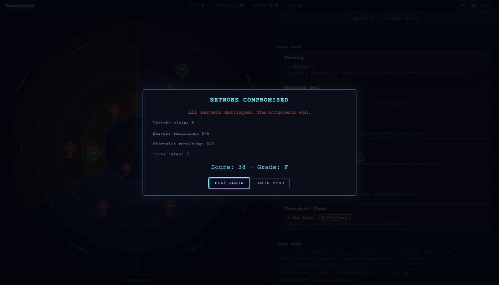

# PumaPanic

**A cybersecurity tower-defense card game** — Defend your network from cyber threats in this single-player turn-based strategy game.

Inspired by [Castle Panic](https://firesidegames.com/products/castle-panic-second-edition) by Justin De Witt, re-themed around IT security operations.

## Play

[greykit.com/games/pumapanic](https://greykit.com/games/pumapanic/)

No install required. Single HTML file, runs in any modern browser.

## How It Works

The rules are a one-for-one port of the Castle Panic base game, re-themed: Forest → Internet, Archer/Knight/Swordsman rings → Perimeter/Network/Endpoint, Castle → Core, Walls → Firewalls, Towers → Servers, Goblins/Orcs/Trolls → Script Kiddies/Malware/APTs.

Your network is concentric rings — **Internet** (outer), **Perimeter**, **Network**, **Endpoint**, and **Core** (center) — split into six segments in three colour pairs. Six servers sit in the Core behind six firewalls. Threats spawn in the Internet ring and advance one ring inward each turn.

Each turn: draw up to a full hand, optionally discard one card and draw a replacement, play as many cards as you like, then every threat advances and two new tokens are drawn. Cards must match both the **ring** and the **segment pair** of the threat you target.

A threat at the Endpoint destroys the firewall in its segment, then the server behind it, **taking 1 damage each time**. Only when nothing is left in its segment does it slip into the Core and circle clockwise. Endpoint cards can still reach it there.

You win when the token deck is empty, the board is clear, and at least one server stands.

## Features

- **Faithful base-game rules** — 49-card deck, 49-token threat deck, draw/discard/play/advance/spawn turn structure, two-card firewall rebuilds, hardened firewalls, outages, lateral movement
- **Add-ons in the difficulty system** — Everything not in the base game is an opt-in house rule: Active Defense, Escalation cards, the Nation State boss, Zero-Day event tokens, Misconfigured dead cards
- **3 presets** — Beginner, Standard (the full base game), Hard
- **Animated events** — Smooth threat movement, FLIP card animations, screen pulse on critical events, colour-coded SIEM feed
- **Tactical look** — the cyan-on-navy palette PumaRally, PumaTycoon and PumaTriage share, monospace terminal type
- **Sound effects** — Web Audio API procedurally generated retro sounds (mutable)
- **Tutorial** — 7-step guided introduction on first play
- **Accessible** — Keyboard shortcuts, screen reader announcements, prefers-reduced-motion support, stacked layout on phones

## Cards (49)

| Card | Count | Effect |
|---|---|---|
| Perimeter / Network / Endpoint Def | 3 per pair, 27 total | 1 damage in that ring, matching segment pair. Endpoint cards also reach the Core |
| Firewall Rule / Network ACL / Host Patch | 1 each | 1 damage in that ring, any segment |
| Incident Commander | 1 per pair | 1 damage in any ring, matching segment pair |
| Contractor | 1 | Eliminate 1 threat anywhere (not the Internet) |
| Sinkhole | 1 | Eliminate 1 threat in the Perimeter, Network or Endpoint ring |
| Quarantine | 1 | Send 1 threat back to the Internet ring |
| Honeypot | 1 | 1 threat does not move next Advance |
| Harden | 1 | A standing firewall takes 2 hits to destroy |
| Hardware + Config | 4 each | Play both together to rebuild a firewall in front of a standing server |
| Threat Intel | 2 | Draw 2 cards |
| Forensics | 1 | Take any 1 card from the discard pile |

## Threat Tokens (49)

| Token | Count | Notes |
|---|---|---|
| Script Kiddie | 12 | 1 HP |
| Malware | 12 | 2 HP |
| APT | 10 | 3 HP |
| Botnet Cmdr | 1 | Boss, 3 HP — on arrival, draw 3 more tokens |
| Ransomware | 1 | Boss, 3 HP — on arrival, draw 4 more tokens |
| Supply Chain | 1 | Boss, 3 HP — on arrival, every threat heals 1 HP |
| Outage: Perimeter / Network / Endpoint | 1 each | Discard every card of that ring from your hand |
| DDoS Attack | 2 | A random segment is flooded: every threat in it is wiped out, then its firewall (or server) falls |
| Coordinated Attack | 2 | Draw 3 more tokens |
| Mass Campaign | 1 | Draw 4 more tokens |
| Lateral Movement (↻ / ↺) | 2 each | Every threat shifts one segment |

Deck counts are from memory of the base game and live in one table at the top of `index.html`; adjust them there if your copy differs.

## Add-ons (house rules, off by default)

| Add-on | Effect |
|---|---|
| Active Defense | +1 or +2 extra damage to a threat that hits a firewall or server |
| Escalation Cards | 2 extra cards dealing 2 damage in the outer rings |
| Nation State | Extra 4 HP boss, immune to Perimeter-ring cards |
| Zero-Day Exploits | 2 extra event tokens: threats in the Perimeter and Network rings surge 1 ring |
| Misconfigurations | 0–5 dead cards shuffled into the deck |

## Keyboard Shortcuts

| Key | Action |
|---|---|
| 1-9 | Select card from hand |
| Enter/Space | Skip discard or end play phase |
| Escape | Deselect card / close dialogs |
| H | Toggle How to Play |
| M | Toggle sound |

## Tech

- Single HTML file (~3000 lines), vanilla JS/CSS
- HTML5 Canvas for the game board
- Web Audio API for procedurally generated sound effects
- No frameworks, no dependencies, no build step
- localStorage for tutorial state

## Other Puma Games

- [PumaSOC](https://pumasoc.greykit.com) — SOC management simulator
- [PumaSecure](https://pumasecure.greykit.com) — Infosec roguelike network defense
- [PumaClicker](https://pumaclicker.greykit.com) — Idle clicker

## Credits

Game design and code by [shandower](https://gitlab.com/shandower) with AI assistance from Claude.

Inspired by Castle Panic by Justin De Witt / Fireside Games.

