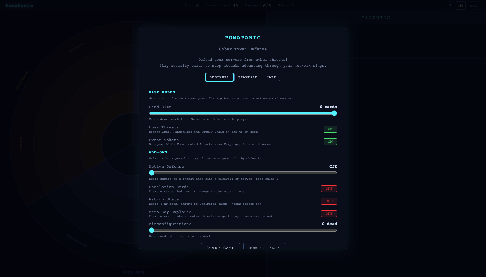
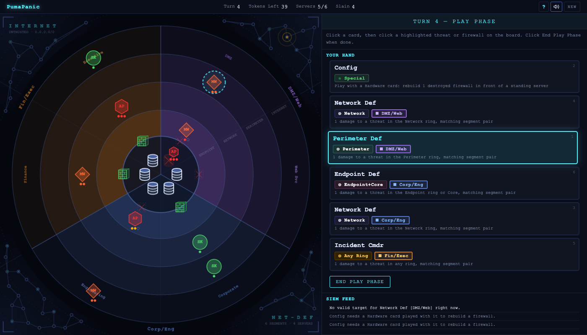

# PumaPanic

**A cybersecurity tower-defense card game.** Defend a network from cyber threats in a single-player, turn-based strategy game. Inspired by [Castle Panic](https://firesidegames.com/products/castle-panic-second-edition) by Justin De Witt, re-themed around IT security operations: the rules are a one-for-one port of the Castle Panic base game.

**Play:** [greykit.com/games/pumapanic](https://greykit.com/games/pumapanic/)

## How it plays

The network is concentric rings — **Internet** (outer), **Perimeter**, **Network**, **Endpoint**, and **Core** (center) — split into six segments in three colour pairs. Six servers sit in the Core behind six firewalls. Threats spawn in the Internet ring and advance one ring inward each turn. Each turn: draw up to a full hand, optionally discard one card and draw a replacement, play as many cards as you like, then every threat advances and two new tokens are drawn. Cards must match both the **ring** and the **segment pair** of the threat they target. A threat at the Endpoint destroys the firewall in its segment, then the server behind it, before slipping into the Core. You win when the token deck is empty, the board is clear, and at least one server stands.

Three presets, Beginner, Standard (the full base game) and Hard, sit under **Custom game** on the title screen. Everything not in the base game is an opt-in house rule: Active Defense, Escalation cards, the Nation State boss, Zero-Day event tokens and Misconfigured dead cards. A short tutorial runs on first play.

## Keys

| Key | Action |
|---|---|
| 1-9 | Select card from hand |
| Enter/Space | Skip discard or end play phase |
| Escape | Deselect card / close dialogs |
| H | Toggle How to Play |
| M | Toggle sound |

## Saves

Only the sound setting and whether the tutorial has been seen are kept, in the browser's `localStorage` under keys starting `pumapanic_`. **Settings → Forget everything** clears them.

## Credits

Inspired by Castle Panic by Justin De Witt / Fireside Games.

By Matthew "Shan" Romanek, with Claude. Built by [greykit.com](https://greykit.com/).

Made for my own play. Nothing here is offered: no support, no updates, no licence.
